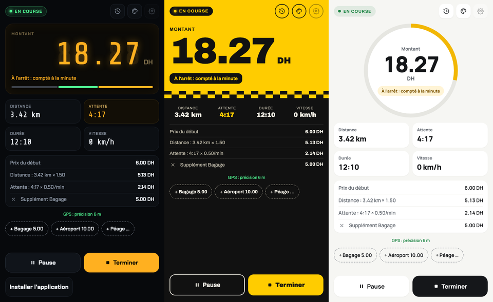
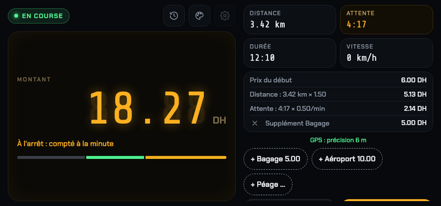
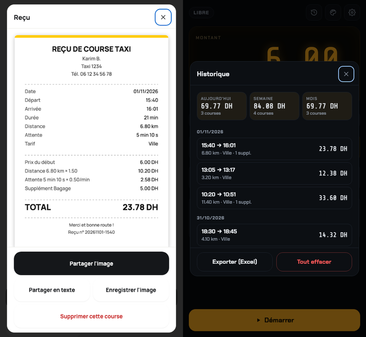

# Compteur Taxi

Taximètre pour le chauffeur, sur téléphone : le prix démarre au **prix du début**, monte **au kilomètre** quand le taxi roule et **à la minute** quand il est à l'arrêt ou au ralenti. Historique des courses, suppléments, plusieurs tarifs et reçu à partager. Tout fonctionne **sans internet** et reste **sur le téléphone**.

**Ouvrir l'appli : https://vantaflow.github.io/taxi-compteur/**



## Sommaire

- [Installer sur le téléphone](#installer-sur-le-téléphone)
- [Utilisation](#utilisation)
- [Comment le prix est calculé](#comment-le-prix-est-calculé)
- [Réglages](#réglages)
- [Historique et reçu](#historique-et-reçu)
- [Sans internet et vie privée](#sans-internet-et-vie-privée)
- [Limites connues](#limites-connues)
- [Pour les développeurs](#pour-les-développeurs)

## Installer sur le téléphone

C'est une appli web installable (PWA) : pas de store, pas de compte, gratuite. Une fois installée, elle s'ouvre en plein écran comme une appli normale.

| Téléphone | Étapes |
|---|---|
| **iPhone** | Ouvrir le lien dans **Safari**, bouton **Partager**, puis **« Sur l'écran d'accueil »**. |
| **Android** | Ouvrir le lien dans **Chrome**, bouton **« Installer l'application »** en bas de l'écran (ou menu ⋮ › « Installer l'application »). |

Au premier démarrage d'une course, le téléphone demande l'accès à la **localisation** : il faut l'accepter, sinon seul le temps est compté.

Les mises à jour arrivent toutes seules à l'ouverture de l'appli quand le téléphone a du réseau.

## Utilisation

1. **Choisir le tarif** (Ville, Aéroport…) sur l'écran d'accueil, s'il y en a plusieurs.
2. **Démarrer** : le compteur affiche le prix du début et l'écran reste allumé.
3. Pendant la course :
   - l'état indique **« En route : compté au kilomètre »** ou **« À l'arrêt : compté à la minute »** ;
   - les boutons **+ Bagage**, **+ Aéroport**, **+ Péage**… ajoutent un supplément (✕ dans le détail pour le retirer) ;
   - **Pause** arrête le compteur (rien n'est compté), **Reprendre** le relance.
4. **Terminer** : le montant à payer s'affiche, la course part dans l'historique.
5. **Reçu** pour le partager, ou **Nouvelle course**.

L'appli marche à la verticale comme à l'horizontale (support de voiture) :



### Trois styles d'affichage

Bouton palette en haut à droite, changeable à tout moment, même pendant une course :

- **Néon nuit** : sombre, chiffres lumineux façon compteur, barre de répartition début / distance / attente.
- **Jaune taxi** : fond jaune, énorme prix noir, très lisible en plein soleil.
- **Épuré clair** : prix dans un anneau qui fait un tour par minute d'attente (ou par kilomètre en roulant).

## Comment le prix est calculé

```
Prix = prix du début
     + kilomètres parcourus × prix par km
     + minutes d'attente × prix par minute
     + suppléments
```

- **Au-dessus de la vitesse seuil** (10 km/h par défaut), on compte la **distance**.
- **En dessous** (feu rouge, bouchon, attente du client), on compte le **temps**.
- Jamais les deux en même temps, comme un vrai taximètre.
- **Tarif de nuit** : la majoration s'applique au km et à la minute, pas au prix du début ni aux suppléments.
- **Course minimum** : si le compteur est en dessous, on facture le minimum ; les suppléments s'ajoutent ensuite.

Exemple avec 6,00 de prix du début, 1,50 par km et 0,50 par minute : 3,42 km et 4 min 17 s d'attente, plus un bagage à 5,00, donnent 6,00 + 5,13 + 2,14 + 5,00 = **18,27 DH**.

### GPS et écran verrouillé

- Les positions imprécises (plus de 50 m) et les sauts aberrants sont ignorés ; les petits mouvements du GPS à l'arrêt ne sont pas comptés comme de la distance.
- Si le GPS se coupe (écran verrouillé, tunnel), le temps est d'abord compté en attente provisoire. À la position suivante, l'appli régularise : la ligne droite parcourue est facturée en distance, majorée de 25 % pour approcher la route réelle, et seul le temps qui n'a pas pu servir à rouler (sur une base de 30 km/h) reste en attente. Pas de double facturation.

## Réglages

Bouton ⚙︎ (désactivé pendant une course). Le bouton **?** affiche une explication sous chaque champ et un exemple de calcul qui suit les valeurs saisies.

| Section | Contenu |
|---|---|
| **Tarif** | Plusieurs tarifs enregistrés (**+ Nouveau**, **Supprimer ce tarif**), chacun avec son nom, prix du début, prix par km, prix par minute, vitesse seuil, course minimum, devise et tarif de nuit (majoration en %, heures de début et de fin, déclenchement automatique). Pour un **forfait**, mettre le prix dans « Prix du début » et 0 au km et à la minute. |
| **Suppléments** | Boutons affichés pendant la course : nom et montant. Montant vide = demandé à chaque fois (péage). |
| **Reçu** | Nom du chauffeur, numéro du taxi, téléphone : en haut du reçu, tous facultatifs. |

Les nouveaux tarifs s'appliquent à la prochaine course : une course en cours garde ceux avec lesquels elle a démarré.

## Historique et reçu



**Historique** (icône horloge) :

- totaux d'**aujourd'hui**, de la **semaine** (depuis lundi) et du **mois**, avec le nombre de courses ;
- liste des courses par jour ; toucher une course ouvre son reçu, d'où on peut aussi la supprimer ;
- **Exporter (Excel)** : fichier CSV (séparateur `;`, virgule décimale) qui s'ouvre directement dans Excel ;
- **Tout effacer**, avec confirmation.

**Reçu**, fabriqué sur le téléphone, sans internet :

- **Partager l'image** : ticket PNG vers WhatsApp, SMS, mail… ;
- **Partager en texte** : version texte du même reçu (copiée dans le presse-papiers si le partage n'est pas disponible) ;
- **Enregistrer l'image**, ou appui long sur l'image pour l'enregistrer dans les photos.

## Sans internet et vie privée

- Après la première ouverture, tous les fichiers de l'appli, **polices comprises**, sont gardés sur le téléphone : elle fonctionne en mode avion.
- Le GPS fonctionne sans réseau.
- Aucune donnée n'est envoyée nulle part : tarifs, courses et historique sont stockés **uniquement sur le téléphone** (stockage du navigateur). Il n'y a ni serveur, ni compte, ni statistiques.
- Conséquence : désinstaller l'appli ou effacer les données de Safari / Chrome efface aussi l'historique. **Exporter régulièrement** pour le garder.
- Seul l'envoi d'un reçu dépend de l'appli choisie pour le partager (WhatsApp a besoin de réseau pour transmettre le message).

## Limites connues

- **Écran verrouillé** : une appli web est mise en pause par le téléphone, le GPS s'arrête. L'appli garde donc l'écran allumé pendant une course, et régularise le prix au déverrouillage (voir plus haut).
- **Pas d'affichage dans la Dynamic Island** ni de notification en direct : il faudrait une appli native.
- **Distance GPS** : elle peut s'écarter un peu d'un taximètre homologué (précision du GPS, détours pendant une coupure). L'appli n'est pas un taximètre homologué.
- Le stockage du navigateur est limité (quelques Mo) : l'historique garde les **5 000** dernières courses.

## Pour les développeurs

Aucune dépendance, aucun outil de construction : HTML, CSS et JavaScript (modules ES) servis tels quels.

```
index.html            page unique : écran du compteur et fenêtres (réglages, historique, reçu, styles)
style.css             mise en page, trois styles (data-style), affichage à l'horizontale
app.js                interface : rendu, boutons, GPS, réglages, historique, reçu
meter.js              logique du compteur (pure, sans DOM) : distance, attente, coupures GPS, suppléments
donnees.js            stockage local : tarifs enregistrés, suppléments, historique, totaux, export CSV
recu.js               reçu en texte et en image (canvas)
sw.js                 service worker : cache de tous les fichiers pour l'usage hors ligne
manifest.webmanifest  installation (nom, icônes, plein écran)
fonts/                polices embarquées (licence SIL OFL)
icons/                icônes de l'appli
test/                 tests (node:test)
docs/captures/        captures d'écran du README
```

### Lancer en local

```bash
python3 -m http.server 8765
# puis ouvrir http://localhost:8765
```

Le GPS des navigateurs n'est disponible qu'en HTTPS ou sur `localhost`. Pour tester sur un téléphone, il faut donc passer par la version en ligne ou un tunnel HTTPS.

### Tests

```bash
npm test
```

Node 18 ou plus récent, sans rien installer. Les tests couvrent le calcul (arrêt, roulage, pause, coupures GPS, suppléments, minimum), les tarifs enregistrés et la reprise de l'ancien réglage, l'historique et ses totaux, l'export CSV et le texte du reçu.

### Publier une modification

Le site est servi par **GitHub Pages** depuis la branche `main` (racine du dépôt) : un `git push` suffit, la mise en ligne prend une à deux minutes.

À chaque modification de fichiers servis, pour que les téléphones prennent la nouvelle version :

1. incrémenter `CACHE` dans `sw.js` (`taxi-vN`) ;
2. incrémenter le paramètre `?v=N` de `style.css` et `app.js` dans `index.html` ;
3. ajouter tout nouveau fichier à la liste `FICHIERS` de `sw.js`, sinon il ne sera pas disponible hors ligne.

### Données stockées (localStorage)

| Clé | Contenu |
|---|---|
| `taxi.profils`, `taxi.profilActif` | tarifs enregistrés et tarif choisi |
| `taxi.supplements` | boutons de suppléments |
| `taxi.recu` | nom, numéro de taxi, téléphone du reçu |
| `taxi.historique` | courses terminées (5 000 au plus, la plus récente en premier) |
| `taxi.course` | course en cours, pour la reprendre après fermeture de l'appli |
| `taxi.style`, `taxi.aide` | style d'affichage, aide des réglages affichée ou non |

L'ancienne clé `taxi.tarifs` (tarif unique des premières versions) est reprise automatiquement comme tarif « Ville ».
